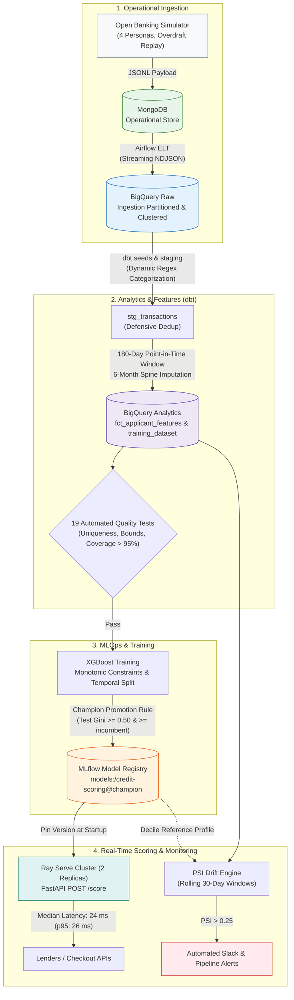

# Real-Time Credit Scoring & MLOps Platform (Open Banking PSD2)

[](https://www.python.org/)
[](https://cloud.google.com/bigquery)
[](https://www.getdbt.com/)
[](https://airflow.apache.org/)
[](https://mlflow.org/)
[](https://docs.ray.io/en/latest/serve/index.html)
[](https://www.docker.com/)

An industrial-grade, end-to-end data platform and real-time scoring system that evaluates retail loan applicant default risk from raw Open Banking (PSD2) transaction streams in under **25 milliseconds**.

Built on the modern fintech data stack: **MongoDB $\to$ Apache Airflow $\to$ Google BigQuery $\to$ dbt $\to$ XGBoost & MLflow $\to$ Ray Serve**, featuring automated data contracts, training-serving parity verification, and statistical drift monitoring.

---

## 🏗️ Architecture & Data Lifecycle



---

## 💡 Key Architectural & Engineering Decisions

### 1. Point-in-Time Correctness & Zero Data Leakage
* **Strict Temporal Lookback:** Feature extraction strictly restricts transactions to the 180 days *before* the application date (`booking_date < application_date` and `>= application_date - 180d`). The application date itself is excluded to prevent decision-day contamination.
* **The "Spine" Pattern:** To eliminate survivorship and empty-window bias (e.g., freelancers with zero income in months 2 and 3), a Cartesian product (`cross join unnest(generate_array(0, 5))`) guarantees exactly 6 distinct monthly buckets per applicant. Missing months are imputed to `0 €` rather than omitted, preserving true volatility and mean income.
* **Temporal Holdout Split:** Train/test splits are split strictly by date (train before `2025-04-01`, test after), never by random shuffle, replicating production deployment conditions.

### 2. Elimination of Training-Serving Skew
* **Dual Execution, Single Source of Truth:** Batch training features are computed in BigQuery SQL via dbt, while online inference features are computed in-memory via Python (`features/compute.py`). Both read the **exact same version-controlled CSV** (`category_rules.csv`).
* **Automated Parity Guard:** An automated parity test (`tests/test_parity.py`) samples 200 real applications from BigQuery, recomputes their features in Python, and asserts numerical equivalence across all columns to a tolerance of `1e-6` before model training is allowed to proceed.
* **Statistical Alignment:** Explicit adjustments handle divergences between engines, such as population standard deviation (`STDDEV_POP` vs. Pandas `ddof=0`) and null safety (`SAFE_DIVIDE` vs. `math.nan`).

### 3. BigQuery Optimization & Partition-Level Idempotence
* **Sandbox & Cost Optimization:** BigQuery Sandbox prohibits DML (`MERGE`, `DELETE`). The ingestion pipeline uses atomic batch Load Jobs (`load_table_from_file`) streaming Newline-Delimited JSON (NDJSON) directly from disk, requiring near-zero worker RAM.
* **Partition Decorators (`table$YYYYMMDD`):** Incremental loads target partition decorators with `WRITE_TRUNCATE`. Re-running a failed Airflow task safely overwrites that specific day's slice without generating duplicate rows.
* **Account Clustering:** Raw tables and staging models are clustered on `account_id`, co-locating an applicant's transactions on disk and drastically reducing query bytes scanned during window aggregations.

### 4. Regulatory Explainability & the EU AI Act
* **Monotonic XGBoost Constraints:** Credit scoring models are designated as high-risk systems under the EU AI Act. XGBoost enforces strict directional monotonicity:
  * `avg_monthly_income`: `-1` (Higher income cannot increase risk).
  * `n_rejected_debits`: `+1` (Payment rejections cannot decrease risk).
  * `negative_balance_days`: `+1` (Overdraft days cannot decrease risk).
  * `gambling_share`: `+1` (Gambling spend cannot decrease risk).
* **The Rent Trap:** No monotonic constraint is placed on `rent_to_income`. Distressed borrowers systematically show lower measured rent outflows because their direct debits are rejected by the bank (`FRAIS REJET PRELEVEMENT`) and never settle as paid rent.

### 5. Production Serving Under 25ms
* **Distributed Ray Serve Cluster:** Ray Serve runs 2 concurrent actor replicas with shared memory (`shm_size: 2gb`).
* **Startup Model Pinning:** Each replica queries MLflow once at startup to resolve the `@champion` alias, caching the compiled XGBoost model in process memory and eliminating per-request network overhead.
* **FastAPI & Pydantic Validation:** Strict schema validation rejects malformed requests (`422 Unprocessable Entity`), while NaN sanitization ensures compliant JSON output (`null`).

### 6. Observability for 12-Month Lagged Labels (PSI Drift)
* **The Ground Truth Delay:** Loan default outcomes take 12 months to mature. Performance metrics (AUC/Gini) cannot be computed in real time.
* **Population Stability Index (PSI):** During training, MLflow logs decile reference distributions (`monitoring/reference_profile.json`). A scheduled drift job evaluates the last 30 days of production applications against this baseline.
* **Threshold Alerts:** Features with $\text{PSI} < 0.10$ are flagged as stable, $0.10 - 0.25$ as moderate shift, and $> 0.25$ triggers automated alerts and blocks model promotion.

---

## 📊 Benchmark & Model Results

| Evaluation Metric | Training Set | Test Set (Holdout) | Target Industry Benchmark | Status |
| :--- | :---: | :---: | :---: | :---: |
| **Gini Coefficient ($2 \times \text{AUC} - 1$)** | **0.850** | **0.709** | $> 0.60$ (Consumer Credit) | ✅ Promoted as `@champion` |
| **AUC-ROC** | **0.925** | **0.855** | $> 0.80$ | ✅ High Discriminative Power |
| **Default Rate Calibration** | 10.0% | 9.8% | 10.0% ($\pm 0.5\%$) | ✅ Calibrated via Bisection |
| **API Median Latency** | — | **24 ms** | $< 50\text{ ms}$ | ✅ Production Ready |
| **API p95 Latency** | — | **26 ms** | $< 100\text{ ms}$ | ✅ Production Ready |
| **Data Quality Tests** | — | **19 / 19 Passed** | 100% Pass Rate | ✅ Zero Schema Violations |

---

## 📁 Repository Structure

```plaintext
algoan-credit-scoring/
├── docker-compose.yml           # Multi-container topology (mongo, mlflow, airflow, scorer)
├── Makefile                     # Standardized developer workflows (make data, dbt, train, score)
├── requirements.txt             # Pinned project dependencies (Python 3.12)
├── .env.example                 # Environment configuration template
│
├── airflow/
│   └── Dockerfile               # Isolated Airflow image with dedicated dbt & ML virtualenvs
│
├── generator/
│   └── generate.py              # Open Banking generator (4 personas, balance replay, bisection)
│
├── scripts/
│   ├── load_mongo.py            # Idempotent bulk upsert loader with index creation
│   └── sample_request.py        # Real-time scoring latency & p95 benchmarking script
│
├── pipelines/
│   └── ingestion.py             # Stream NDJSON extraction & BigQuery partition-load jobs
│
├── dags/
│   └── credit_scoring_pipeline.py # Airflow DAG (Ingest -> dbt build -> Parity -> Train -> Drift)
│
├── dbt/credit_scoring/          # Complete dbt transformation project
│   ├── dbt_project.yml          # Project configuration & materialization strategies
│   ├── profiles.yml             # BigQuery credentials & connection pooling
│   ├── seeds/
│   │   └── category_rules.csv   # Regex categorization dictionary (Shared with Python)
│   ├── models/
│   │   ├── staging/             # stg_transactions, stg_applications, stg_outcomes, _sources.yml
│   │   └── marts/               # fct_applicant_features, training_dataset, _marts.yml
│   └── tests/                   # assert_categorization_coverage.sql, assert_feature_ranges.sql
│
├── features/
│   └── compute.py               # In-memory Python twin of dbt SQL feature engineering
│
├── training/
│   └── train.py                 # Monotonic XGBoost, MLflow logging, Champion/Challenger promotion
│
├── serving/
│   ├── app.py                   # Ray Serve + FastAPI real-time scoring deployment
│   ├── config.yaml              # Ray Serve HTTP runtime configuration
│   └── Dockerfile               # Lightweight scoring container
│
├── monitoring/
│   ├── psi.py                   # Decile binning & Population Stability Index calculation
│   └── drift.py                 # Scheduled drift detection job writing to BigQuery
│
└── tests/
    ├── test_features.py         # Unit tests for feature window bounds & priority logic
    ├── test_parity.py           # Training-serving skew verification test (SQL == Python)
    └── test_psi.py              # Statistical tests for PSI math and NaN handling
```

---

## 🚀 Quickstart & Reproduction Guide

### Prerequisites
* Docker & Docker Compose (v24+)
* Linux / WSL2 with Python 3.12 and GNU Make
* Google Cloud account with a free BigQuery Sandbox project

### 1. Environment Setup
```bash
# Clone the repository
git clone https://github.com/your-username/algoan-credit-scoring.git
cd algoan-credit-scoring

# Create local Python virtual environments
python3.12 -m venv .venv && .venv/bin/pip install -r requirements.txt "ray[serve]==2.58.0"
python3.12 -m venv .venv-dbt && .venv-dbt/bin/pip install dbt-bigquery==1.12.1

# Configure environment variables
cp .env.example .env
# Set GCP_PROJECT=your-gcp-project-id in .env

# Place your Google Cloud Service Account key (with BigQuery Data Editor & Job User roles)
mkdir -p secrets
cp /path/to/your-key.json secrets/gcp-key.json
```

### 2. Launch Core Services
```bash
docker compose up -d mongo mlflow airflow
```
* **MLflow UI:** `http://localhost:5000`
* **Airflow UI:** `http://localhost:8080` (credentials printed in `docker compose logs airflow`)

### 3. Generate Data & Ingest
```bash
# 1. Generate 3,000 synthetic Open Banking accounts (631K transactions, 10% default rate)
make data

# 2. Bulk load idempotently into MongoDB
make load

# 3. Trigger Airflow DAG (or trigger via Web UI with full_refresh=True)
# Ingestion flattens MongoDB documents into BigQuery raw tables
```

### 4. Build Analytical Features & Run Tests
```bash
# Run dbt seeds, models, and 19 automated data quality tests
make dbt
```

### 5. Train & Promote Model to Champion
```bash
# Train monotonic XGBoost, compute reference profile, register version in MLflow
make train
```

### 6. Serve Scores in Real Time
```bash
# Launch Ray Serve scorer container
docker compose --profile serving up -d --build scorer

# Verify health
curl localhost:8000/health
# {"status":"ok","model":"credit-scoring","model_version":"1"}

# Generate 800 recent production applications & benchmark latency
make prod
make score
```

### 7. Run Population Drift Check
```bash
# Evaluate recent traffic against the champion training distribution
make drift

# Simulate population shift (higher rents, more gambling, more fragile profiles)
make prod-drift load-prod
# Re-running drift detection catches the shift and flags alerts on rent_to_income
```

---

## 🔮 Enterprise Production Roadmap

In a large-scale enterprise deployment handling tens of millions of daily banking events:
1. **Distributed Stream Processing:** Replace the single-worker Airflow ingestion script with an **Apache Beam / Google Cloud Dataflow** pipeline streaming transactions from Kafka/PubSub directly into BigQuery in compressed Parquet/Avro.
2. **Kubernetes Orchestration:** Deploy Ray Serve on Kubernetes via **KubeRay**, enabling GPU/CPU horizontal pod autoscaling based on incoming request queue depth.
3. **Shadow Deployments:** Route live traffic to challenger models in "shadow mode" (dual scoring without affecting loan decisions) to evaluate real-world score stability before flipping the `@champion` alias.
4. **Managed Feature Store:** Adopt **Feast** or **Hopsworks** to unify online Redis feature retrieval with offline BigQuery training sets, further streamlining training-serving parity.
